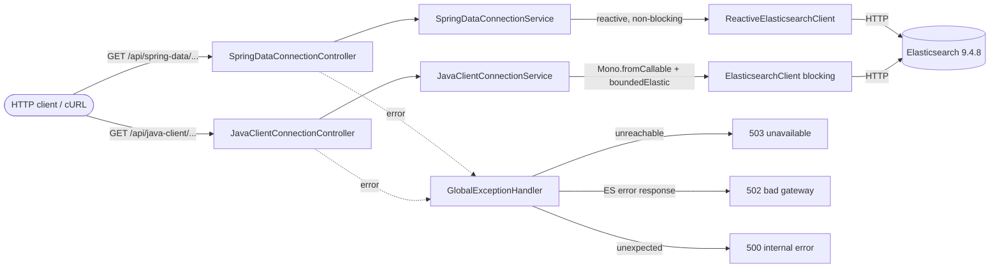

# 🔌 Chapter 01 — Basic Connection

> บทนี้สาธิตการเชื่อมต่อ Spring Boot WebFlux กับ Elasticsearch ที่รันอยู่บนเครื่อง Local โดยไม่ใช้ Authentication ผ่าน Elasticsearch Client สองรูปแบบ ได้แก่ Spring Data Elasticsearch (Reactive) และ Elasticsearch Java API Client (Blocking) เพื่อเปรียบเทียบแนวทางการเชื่อมต่อและการทำงานของแต่ละ Client

บทเริ่มต้นของคลังเรียนรู้ จบบทนี้คุณจะ: ต่อ Spring WebFlux เข้ากับ Elasticsearch node แบบ local ได้จริง,
เรียก **cluster health** และ **cluster info** ผ่าน REST ด้วยทั้งสอง client, และเข้าใจความต่างระหว่าง
**reactive (non-blocking)** กับ **synchronous (blocking)** พร้อมวิธี isolate งาน blocking ให้ปลอดภัยบน WebFlux

## 📑 Table of Contents
- [Overview](#-overview)
- [Learning Objectives](#-learning-objectives)
- [Prerequisites](#-prerequisites)
- [Core Concepts](#-core-concepts)
- [Architecture / How It Works](#-architecture--how-it-works)
- [Project Structure](#-project-structure)
- [Configuration](#-configuration)
- [Getting Started](#-getting-started)
- [API Examples](#-api-examples)
- [Error Handling](#-error-handling)
- [Testing](#-testing)
- [Key Takeaways](#-key-takeaways)
- [Common Pitfalls](#-common-pitfalls)

## 🧭 Overview
เป้าหมายคือทำให้แอป Spring WebFlux เชื่อมต่อกับ Elasticsearch node แบบ local ได้สำเร็จ และเรียก
cluster information / cluster health ออกมาได้จริง โดยเปรียบเทียบ **สองวิธีการเชื่อมต่อ**:

- **Spring Data Elasticsearch (reactive)** — ใช้ `ReactiveElasticsearchClient` ที่คืนค่าเป็น `Mono`/`Flux` แบบ non-blocking
- **Official Elasticsearch Java API Client** — ใช้ `ElasticsearchClient` ซึ่งเป็น client แบบ **synchronous (blocking)**

ทั้งสองวิธีต้องเรียกไปยัง Elasticsearch จริง ไม่ใช่คืนค่า `UP` แบบ hardcode

## 🎯 Learning Objectives
เมื่อจบบทนี้ คุณจะสามารถ:
- รัน Elasticsearch แบบ single-node บน Docker (local, no-auth) ได้อย่างปลอดภัย
- ตั้งค่า Spring Boot ให้ auto-configure ทั้งสอง client ด้วย property เดียว (`spring.elasticsearch.uris`)
- อธิบายความแตกต่างระหว่าง **reactive (non-blocking)** และ **synchronous (blocking)** client
- เข้าใจว่าทำไมต้องใช้ `Schedulers.boundedElastic()` เมื่อเรียก blocking client ในแอป WebFlux
- เขียน integration test ที่ยิงไปยัง Elasticsearch จริงด้วย Testcontainers

## 📋 Prerequisites
- Java 21
- Maven
- Docker + Docker Compose (สำหรับรัน Elasticsearch แบบ local)
- `curl` และ `jq` (สำหรับตัวอย่าง API)

## 🧠 Core Concepts

### Reactive vs Blocking (สำคัญมาก)
WebFlux ทำงานบน event loop ของ reactor-netty ซึ่งมี thread จำนวนน้อยและคงที่ **ห้าม block thread เหล่านี้เด็ดขาด**
มิฉะนั้น throughput ของทั้งเซิร์ฟเวอร์จะพังทันที

| หัวข้อ | Spring Data `ReactiveElasticsearchClient` | Official `ElasticsearchClient` |
|---|---|---|
| ชนิด client | reactive | synchronous |
| การทำงาน | non-blocking I/O | blocking (รอจน response กลับ) |
| return type | `Mono` / `Flux` | ค่า response ตรง ๆ (เรียก throw `IOException` ได้) |
| พฤติกรรม thread | รันบน event loop ได้เลย | จะ block thread ที่เรียก |
| ต้องใช้ `boundedElastic`? | ไม่ต้อง | **ต้อง** — ย้ายงาน blocking ออกจาก event loop |

- **Spring Data `ReactiveElasticsearchClient`**: method คืน `Mono`/`Flux` และทำ I/O แบบ non-blocking อยู่แล้ว เรียกใช้ได้ตรง ๆ
- **Official `ElasticsearchClient`**: เป็น synchronous — method จะ block thread จนกว่าจะได้ response กลับมา
  ดังนั้นในแอป WebFlux เราต้องห่อการเรียกไว้ใน `Mono.fromCallable(...)` แล้วย้ายไปรันบน `Schedulers.boundedElastic()`
  ด้วย `subscribeOn(...)` เพื่อไม่ให้ไป block event loop

> ⚠️ การห่อ **ผลลัพธ์** ด้วย `Mono.just(client.call())` ไม่ได้ช่วยอะไร เพราะ `client.call()` จะยัง block
> บน thread ที่ subscribe อยู่ดี งานที่ block ต้องอยู่ **ข้างใน** lambda ของ `fromCallable` เท่านั้น scheduler จึงจะย้ายไปรันที่อื่นได้

### Cluster API เท่านั้น (ยังไม่แตะ search)
บทนี้เรียกแค่ `cluster health` และ `info` (เทียบเท่า `GET /`) เพื่อพิสูจน์การเชื่อมต่อ — เรื่อง search query เริ่มที่ Chapter 04

## 🏗️ Architecture / How It Works


ทั้งสอง client ถูก auto-configure โดย Spring Boot จาก property `spring.elasticsearch.uris` ตัวเดียว
(Spring Boot 4 ใช้โครงสร้าง `Rest5Client` ใหม่แทน low-level `RestClient` เดิมที่ deprecated ไปแล้ว)

## 📁 Project Structure
โครงสร้างแบบ **layered** (แยกตาม responsibility) ตามมาตรฐานใน `.kiro/steering/structure.md`

```text
01-basic-connection/
├── docker-compose.yml
├── pom.xml
├── README.md
├── VERIFICATION.md
└── src/
    ├── main/
    │   ├── java/com/example/learning/basicconnection/
    │   │   ├── controller/
    │   │   │   ├── JavaClientConnectionController.java
    │   │   │   └── SpringDataConnectionController.java
    │   │   ├── dto/
    │   │   │   ├── ClusterHealthResponse.java
    │   │   │   └── ClusterInfoResponse.java
    │   │   ├── exception/
    │   │   │   └── GlobalExceptionHandler.java
    │   │   ├── service/
    │   │   │   ├── JavaClientConnectionService.java
    │   │   │   └── SpringDataConnectionService.java
    │   │   └── BasicConnectionApplication.java
    │   └── resources/
    │       └── application.yml
    └── test/
        └── java/com/example/learning/basicconnection/
            ├── controller/
            │   ├── JavaClientConnectionControllerTest.java
            │   └── SpringDataConnectionControllerTest.java
            ├── exception/
            │   ├── ErrorThrowingTestController.java
            │   └── GlobalExceptionHandlerTest.java
            ├── integration/
            │   └── ElasticsearchConnectionIT.java
            └── service/
                ├── JavaClientConnectionServiceTest.java
                └── SpringDataConnectionServiceTest.java
```

**ความรับผิดชอบของแต่ละ package:**
- `controller/` — รับ HTTP request/response เท่านั้น (thin controller) ส่งต่อให้ service และคืนค่า `Mono`
- `service/` — logic และการเชื่อมต่อ Elasticsearch แยกชัดเจนระหว่างสอง client (ชื่อ class บ่งบอกวิธีการ)
- `dto/` — สัญญา (contract) ของ response เป็น `record` ล้วน ไม่มี business logic
- `exception/` — จัดการ error รวมศูนย์ด้วย `@RestControllerAdvice`
- application class (`BasicConnectionApplication`) อยู่ที่ **root package** เพื่อให้ component scan ครอบคลุมทุก package

## ⚙️ Configuration

| สิ่งที่ใช้ | เวอร์ชัน |
|---|---|
| Java | 21 (Temurin 21.0.2) |
| Spring Boot | 4.1.2 |
| Spring Framework | 7.0.10 (มาจาก Boot BOM) |
| Spring Data (BOM) | 2026.0.2 (Spring Data Elasticsearch reactive) |
| Elasticsearch Java API Client (`co.elastic.clients`) | 9.4.8 (จัดการโดย Boot BOM) |
| Elasticsearch server (Docker image) | 9.4.8 (ตรงกับเวอร์ชัน client) |
| Testcontainers | 2.0.5 (จาก Boot BOM) |

`application.yml` (ย่อ):
```yaml
spring:
  elasticsearch:
    uris: ${ELASTICSEARCH_URIS:http://localhost:9200}   # ตั้งค่าทั้งสอง client พร้อมกัน
    connection-timeout: 5s
    socket-timeout: 10s
server:
  port: ${SERVER_PORT:8080}
```

Environment variables:
- `ELASTICSEARCH_URIS` — URI ของ Elasticsearch (default `http://localhost:9200`)
- `SERVER_PORT` — พอร์ตของแอป (default `8080`)

### ความปลอดภัย (อ่านก่อน)
- บทนี้ **ปิด security** (`xpack.security.enabled=false`) เพื่อความง่ายในการเรียนรู้ local เท่านั้น
- Elasticsearch ถูก bind ไว้ที่ `127.0.0.1:9200` เข้าถึงได้เฉพาะเครื่องนี้
- **ห้าม** นำโหมด no-auth นี้ไป deploy บน network สาธารณะหรือใช้งานจริงเด็ดขาด (เรื่อง API key อยู่ใน Chapter 02)
- ไม่มีการ hardcode credential ใด ๆ และ error response ถูกออกแบบให้ไม่ leak ข้อมูลการเชื่อมต่อ

## 🚀 Getting Started

**1) เข้าไปที่ไดเรกทอรีของบทนี้**
```bash
cd 01-basic-connection
```

**2) สตาร์ท Elasticsearch** (ใช้ Compose project name แยกเพื่อไม่ชนกับบทอื่น)
```bash
docker compose -p ch01 up -d
```

**3) ตรวจความพร้อม** (ควรได้ status green/yellow)
```bash
curl -s http://127.0.0.1:9200/_cluster/health | jq .
docker compose -p ch01 ps
```

**4) รันเทสต์ทั้งหมด** (unit + integration)
```bash
mvn clean verify
```
> ⚠️ ต้องเปิด Docker daemon ก่อน เพราะ integration test ใช้ Testcontainers — ถ้า Docker ไม่ทำงาน `mvn clean verify` จะไม่ผ่าน

**5) รันแอป**
```bash
mvn spring-boot:run
# หรือรันจาก jar:
# mvn -DskipTests package && java -jar target/basic-connection.jar
```

**6) เรียก API ตัวอย่าง** (ดูหัวข้อ [API Examples](#-api-examples))
```bash
curl --fail-with-body -s http://127.0.0.1:8080/api/spring-data/elasticsearch/health | jq .
```

**7) หยุดและเก็บกวาด** (หยุดแอปด้วย Ctrl+C ก่อน)
```bash
docker compose -p ch01 down   # ลบ container + network (ไม่มี persistent volume ให้ลบ)
```

> หมายเหตุพอร์ต: ถ้าพอร์ต `9200` หรือ `8080` ถูกใช้อยู่ ให้แก้ mapping ใน `docker-compose.yml`
> หรือกำหนด `ELASTICSEARCH_URIS` / `SERVER_PORT` ใหม่

## 📡 API Examples
ทุก endpoint เป็น `GET` และคืน HTTP 200 พร้อม JSON ที่ map เป็น DTO เสถียร

### Spring Data Elasticsearch

**Cluster health** — `GET /api/spring-data/elasticsearch/health`
```bash
curl --fail-with-body -s http://127.0.0.1:8080/api/spring-data/elasticsearch/health | jq .
```
```json
{"client":"spring-data","clusterName":"docker-cluster","status":"green","numberOfNodes":1,"reachable":true}
```

**Cluster info** — `GET /api/spring-data/elasticsearch/cluster-info`
```bash
curl --fail-with-body -s http://127.0.0.1:8080/api/spring-data/elasticsearch/cluster-info | jq .
```
```json
{"client":"spring-data","clusterName":"docker-cluster","clusterUuid":"<uuid>","versionNumber":"9.4.8","tagline":"You Know, for Search"}
```

### Official Elasticsearch Java API Client

**Cluster health** — `GET /api/java-client/elasticsearch/health`
```bash
curl --fail-with-body -s http://127.0.0.1:8080/api/java-client/elasticsearch/health | jq .
```
```json
{"client":"java-client","clusterName":"docker-cluster","status":"green","numberOfNodes":1,"reachable":true}
```

**Cluster info** — `GET /api/java-client/elasticsearch/cluster-info`
```bash
curl --fail-with-body -s http://127.0.0.1:8080/api/java-client/elasticsearch/cluster-info | jq .
```
```json
{"client":"java-client","clusterName":"docker-cluster","clusterUuid":"<uuid>","versionNumber":"9.4.8","tagline":"You Know, for Search"}
```

> ทั้งสอง client เรียก cluster เดียวกัน ค่าจึงตรงกัน ต่างแค่ field `client` ที่บอกว่าใครเป็นผู้เรียก

ตัวอย่าง assertion (field-level):
```bash
curl -s http://127.0.0.1:8080/api/spring-data/elasticsearch/cluster-info \
  | jq -e '.versionNumber=="9.4.8" and (.clusterUuid|length>0)'
```

> ค่าที่เป็น **dynamic** (อย่า assert แบบตายตัว):
> - `clusterName` = `docker-cluster` เป็น default ของ image นี้ (เปลี่ยนได้ผ่าน env `cluster.name`)
> - `clusterUuid` สุ่มใหม่ทุกครั้งที่สร้าง cluster ใหม่ — assert แค่ว่า "ไม่ว่าง"
> - `status` ขึ้นกับสถานะจริงของ cluster — assert ว่าเป็นหนึ่งใน `green`/`yellow`/`red`
> - `versionNumber` = `9.4.8` คงที่เพราะ pin image ไว้

## ⚠️ Error Handling
`GlobalExceptionHandler` จำแนก error ตามสาเหตุจริง ไม่ได้ตอบ 503 กับทุกกรณี และ body เป็น generic เสมอ (ไม่ leak host/uri/credential/stack trace)

| สาเหตุ | Exception | HTTP status | title |
|---|---|---|---|
| request ไป Elasticsearch timeout | `SocketTimeoutException` / `java.util.concurrent.TimeoutException` | **504** Gateway Timeout | `Elasticsearch timeout` |
| ติดต่อ Elasticsearch ไม่ได้ (node ดับ, connection refused, unknown host, I/O) | `ConnectException` / `UnknownHostException` / `IOException` (รวม `TransportException`) | **503** Service Unavailable | `Elasticsearch unavailable` |
| ติดต่อได้ แต่ ES ตอบ error response | `ElasticsearchException` | **502** Bad Gateway | `Elasticsearch returned an error` |
| error อื่นที่ไม่คาดคิดในแอป | อื่น ๆ | **500** Internal Server Error | `Internal server error` |

> หมายเหตุ: `SocketTimeoutException` เป็น subclass ของ `IOException` — handler จึงจัด timeout เป็น 504 ก่อน (เฉพาะเจาะจงกว่า) ไม่ตกไปเป็น 503 และกรณี exception ถูกห่อ (wrapped) จะไล่ดู cause chain เพื่อจำแนกให้ถูก

Failure path (ES ดับ) → ได้ HTTP **503**:
```bash
docker compose -p ch01 stop elasticsearch
curl -s -w '\nSTATUS=%{http_code}\n' http://127.0.0.1:8080/api/java-client/elasticsearch/health
# → {"title":"Elasticsearch unavailable","status":503,"detail":"Could not reach Elasticsearch. ...","instance":"/api/java-client/elasticsearch/health"}  STATUS=503
```

## 🧪 Testing
```bash
mvn clean verify
```
โครงสร้าง test สะท้อน production package (`controller/`, `service/`, `exception/`, `integration/`)

- **Controller tests** (`controller/*Test`, surefire, `@WebFluxTest`): ทดสอบ routing, status code, การ serialize JSON โดย mock service ไว้ รวมถึงเคส ES ติดต่อไม่ได้ → 503
- **Service tests** (`service/*Test`, surefire): mock Elasticsearch client แล้วใช้ `StepVerifier` ยืนยันว่า
  - map response เป็น DTO ถูกต้อง, stream มีค่าเดียวแล้ว complete, และ error ถูก propagate ออกมา (ไม่ถูกกลืน)
  - สำหรับ Java API Client (blocking): ยืนยันว่า blocking call ถูก **isolate ไปรันบน `boundedElastic` worker** (ไม่ใช่ caller/event-loop thread) และ `Mono.fromCallable` เป็น lazy (ไม่เรียก client ก่อน subscribe)
- **Exception tests** (`exception/GlobalExceptionHandlerTest`, surefire, `@WebFluxTest`): ยืนยันการจำแนก error (timeout → 504, unreachable → 503, ES error → 502, อื่น ๆ → 500) รวมถึงเคส wrapped exception และ body ไม่ leak host/uri/stack trace
- **Integration test** (`integration/ElasticsearchConnectionIT`, failsafe ใน phase `verify`): สตาร์ต Elasticsearch 9.4.8 จริงด้วย Testcontainers แล้วเรียกทั้งสอง service เพื่อยืนยันว่าเชื่อมต่อ cluster จริง
  - ต้องมี Docker daemon ทำงานอยู่ มิฉะนั้น integration test จะรันไม่ได้

ขอบเขตการ verify: unit test (controller + service + exception) ไม่แตะ Elasticsearch จริง, ส่วน integration test และ cURL ยืนยันการเชื่อมต่อจริงกับ ES 9.4.8

## 💡 Key Takeaways
- Spring Boot auto-configure ทั้ง reactive client และ synchronous Java API Client จาก property เดียว
- Reactive client เรียกได้ตรง ๆ แต่ synchronous client ต้องย้ายไป `boundedElastic()` เสมอในแอป WebFlux
- ควร expose DTO เสถียรแทน payload ดิบของ vendor เพื่อให้ API contract ไม่เปลี่ยนตาม internal ของ ES
- เวอร์ชัน client กับ server ควรตรงกัน (ที่นี่คือ 9.4.8 ทั้งคู่)
- จำแนก error ตามสาเหตุ (timeout → 504, unreachable → 503, ES error response → 502, อื่น ๆ → 500) ดีกว่าตอบ status เดียวกับทุกกรณี และต้องไม่ leak รายละเอียด infrastructure

## ⚠️ Common Pitfalls
- **Block event loop**: เรียก `ElasticsearchClient` (sync) ตรง ๆ บน thread ของ WebFlux → ใช้ `Mono.fromCallable(...).subscribeOn(Schedulers.boundedElastic())`
- **เวอร์ชัน client/server ไม่ตรงกัน**: อาจทำให้ API บางตัวเพี้ยน ควร pin ให้ตรง
- **Spring Boot 4 เปลี่ยนแพ็กเกจของ test slice**: `@WebFluxTest` ย้ายไป `org.springframework.boot.webflux.test.autoconfigure` (โมดูล `spring-boot-webflux-test`)
- **Testcontainers 2.x เปลี่ยนชื่อ artifact**: ใช้ `testcontainers-junit-jupiter` / `testcontainers-elasticsearch`
- **ลืมสตาร์ท Docker**: integration test และ cURL จะล้มเหลวทันที
- **โหมด no-auth**: ใช้ได้เฉพาะ local เท่านั้น — production ต้องเปิด security (ดู Chapter 02)
