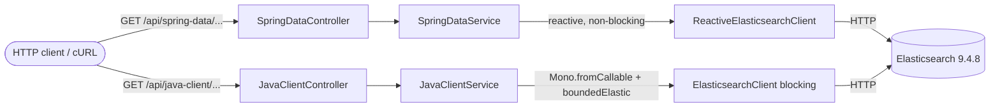

# Chapter 01 — Basic Connection (การเชื่อมต่อ Elasticsearch เบื้องต้น)

> โปรเจกต์ Spring Boot WebFlux อิสระ ที่สาธิตการเชื่อมต่อ Elasticsearch แบบ local (ไม่มี authentication)
> ด้วย **สอง client** ที่แยกกันชัดเจน: Spring Data Elasticsearch (reactive) และ Elasticsearch Java API Client (official)

---

## 1. Overview
บทนี้คือจุดเริ่มต้นของคลังเรียนรู้ เป้าหมายคือทำให้แอป Spring WebFlux เชื่อมต่อกับ Elasticsearch node แบบ local
ได้สำเร็จ และเรียก cluster information / cluster health ออกมาได้จริง โดยเปรียบเทียบ **สองวิธีการเชื่อมต่อ**:

- **Spring Data Elasticsearch (reactive)** — ใช้ `ReactiveElasticsearchClient` ที่คืนค่าเป็น `Mono`/`Flux` แบบ non-blocking
- **Official Elasticsearch Java API Client** — ใช้ `ElasticsearchClient` ซึ่งเป็น client แบบ **synchronous (blocking)**

ทั้งสองวิธีต้องเรียกไปยัง Elasticsearch จริง ไม่ใช่คืนค่า `UP` แบบ hardcode

## 2. Learning Objectives
เมื่อจบบทนี้ คุณจะสามารถ:
- รัน Elasticsearch แบบ single-node บน Docker (local, no-auth) ได้อย่างปลอดภัย
- ตั้งค่า Spring Boot ให้ auto-configure ทั้งสอง client ด้วย property เดียว (`spring.elasticsearch.uris`)
- อธิบายความแตกต่างระหว่าง **reactive (non-blocking)** และ **synchronous (blocking)** client
- เข้าใจว่าทำไมต้องใช้ `Schedulers.boundedElastic()` เมื่อเรียก blocking client ในแอป WebFlux
- เขียน integration test ที่ยิงไปยัง Elasticsearch จริงด้วย Testcontainers

## 3. Concepts

### Reactive vs Blocking (สำคัญมาก)
WebFlux ทำงานบน event loop ของ reactor-netty ซึ่งมี thread จำนวนน้อยและคงที่ ห้าม block thread เหล่านี้เด็ดขาด
มิฉะนั้น throughput ของทั้งเซิร์ฟเวอร์จะพังทันที

- **Spring Data `ReactiveElasticsearchClient`**: method คืน `Mono`/`Flux` และทำ I/O แบบ non-blocking อยู่แล้ว เรียกใช้ได้ตรง ๆ
- **Official `ElasticsearchClient`**: เป็น synchronous — method จะ block thread จนกว่าจะได้ response กลับมา
  ดังนั้นในแอป WebFlux เราต้องห่อการเรียกไว้ใน `Mono.fromCallable(...)` แล้วย้ายไปรันบน `Schedulers.boundedElastic()`
  ด้วย `subscribeOn(...)` เพื่อไม่ให้ไป block event loop

> ⚠️ การห่อ **ผลลัพธ์** ด้วย `Mono.just(client.call())` ไม่ได้ช่วยอะไร เพราะ `client.call()` จะยัง block
> บน thread ที่ subscribe อยู่ดี งานที่ block ต้องอยู่ **ข้างใน** lambda ของ `fromCallable` เท่านั้น scheduler จึงจะย้ายไปรันที่อื่นได้

### Query Context vs การเรียก cluster API
บทนี้ยังไม่แตะ search query — เราเรียกแค่ `cluster health` และ `info` (เทียบเท่า `GET /`) เพื่อพิสูจน์การเชื่อมต่อ

## 4. Project Structure
```
01-basic-connection/
├── docker-compose.yml            # Elasticsearch 9.4.8 single-node, security ปิด, bind 127.0.0.1
├── pom.xml                       # Spring Boot 4.1.2, สอง client, Testcontainers
├── README.md
├── VERIFICATION.md               # รายงานผลการ verify จริง
└── src/
    ├── main/java/com/example/learning/basicconnection/
    │   ├── BasicConnectionApplication.java          # main entry point
    │   ├── dto/
    │   │   ├── ClusterHealthResponse.java           # DTO ที่เสถียร (ไม่ expose payload ดิบ)
    │   │   └── ClusterInfoResponse.java
    │   ├── springdata/                              # วิธีที่ 1: Spring Data (reactive)
    │   │   ├── SpringDataElasticsearchService.java
    │   │   └── SpringDataElasticsearchController.java
    │   ├── javaclient/                              # วิธีที่ 2: official Java API Client (blocking)
    │   │   ├── JavaClientElasticsearchService.java
    │   │   └── JavaClientElasticsearchController.java
    │   └── web/
    │       └── GlobalErrorHandler.java              # map error → 503 โดยไม่ leak ข้อมูล
    ├── main/resources/application.yml
    └── test/java/com/example/learning/basicconnection/
        ├── springdata/SpringDataElasticsearchControllerTest.java   # @WebFluxTest (mock service)
        ├── javaclient/JavaClientElasticsearchControllerTest.java   # @WebFluxTest (mock service)
        └── ElasticsearchConnectionIT.java                          # integration test (Testcontainers, ES จริง)
```

## 5. How It Works


ทั้งสอง client ถูก auto-configure โดย Spring Boot จาก property `spring.elasticsearch.uris` ตัวเดียว
(Spring Boot 4 ใช้โครงสร้าง `Rest5Client` ใหม่แทน low-level `RestClient` เดิมที่ deprecated ไปแล้ว)

## 6. Configuration

| สิ่งที่ใช้ | เวอร์ชัน |
|---|---|
| Java | 21 (Temurin 21.0.2) |
| Spring Boot | 4.1.2 |
| Spring Framework | 7.0.10 (มาจาก Boot BOM) |
| Spring Data (BOM) | 2026.0.2 (Spring Data Elasticsearch reactive) |
| Elasticsearch Java API Client (`co.elastic.clients`) | 9.4.8 (จัดการโดย Boot BOM) |
| Elasticsearch server (Docker image) | 9.4.8 (ตรงกับเวอร์ชัน client) |
| Testcontainers | 2.0.5 (จาก Boot BOM) |

`application.yml` (ย่อ):
```yaml
spring:
  elasticsearch:
    uris: ${ELASTICSEARCH_URIS:http://localhost:9200}   # ตั้งค่าทั้งสอง client พร้อมกัน
    connection-timeout: 5s
    socket-timeout: 10s
server:
  port: ${SERVER_PORT:8080}
```

Environment variables:
- `ELASTICSEARCH_URIS` — URI ของ Elasticsearch (default `http://localhost:9200`)
- `SERVER_PORT` — พอร์ตของแอป (default `8080`)

### ความปลอดภัย (อ่านก่อน)
- บทนี้ **ปิด security** (`xpack.security.enabled=false`) เพื่อความง่ายในการเรียนรู้ local เท่านั้น
- Elasticsearch ถูก bind ไว้ที่ `127.0.0.1:9200` เข้าถึงได้เฉพาะเครื่องนี้
- **ห้าม** นำโหมด no-auth นี้ไป deploy บน network สาธารณะหรือใช้งานจริงเด็ดขาด (เรื่อง API key อยู่ใน Chapter 02)
- ไม่มีการ hardcode credential ใด ๆ และ error response ถูกออกแบบให้ไม่ leak ข้อมูลการเชื่อมต่อ

## 7. Getting Started

Prerequisites: Java 21, Maven, Docker + Docker Compose

```bash
# 1) เข้าไปที่ไดเรกทอรีของบทนี้
cd 01-basic-connection

# 2) สตาร์ท Elasticsearch (ใช้ project name แยกเพื่อไม่ชนกับบทอื่น)
docker compose -p ch01 up -d

# 3) ตรวจความพร้อม (ควรได้ status green/yellow)
curl -s http://127.0.0.1:9200/_cluster/health | jq .
docker compose -p ch01 ps

# 4) build + รัน test ทั้งหมด (unit + integration)
mvn clean verify

# 5) รันแอป
mvn spring-boot:run
#   หรือรันจาก jar:
#   mvn -DskipTests package && java -jar target/basic-connection.jar

# 6) หยุดและเก็บกวาด
#   หยุดแอปด้วย Ctrl+C
docker compose -p ch01 down          # ลบ container + network (ไม่มี persistent volume ให้ลบ)
```

> หมายเหตุพอร์ต: ถ้าพอร์ต `9200` หรือ `8080` ถูกใช้อยู่ ให้แก้ mapping ใน `docker-compose.yml`
> หรือกำหนด `ELASTICSEARCH_URIS` / `SERVER_PORT` ใหม่

## 8. API Examples

ทุก endpoint คืน HTTP 200 พร้อม JSON ที่ map เป็น DTO เสถียร

```bash
# Spring Data — health
curl --fail-with-body -s http://127.0.0.1:8080/api/spring-data/elasticsearch/health | jq .
# → {"client":"spring-data","clusterName":"docker-cluster","status":"green","numberOfNodes":1,"reachable":true}

# Spring Data — cluster info
curl --fail-with-body -s http://127.0.0.1:8080/api/spring-data/elasticsearch/cluster-info | jq .
# → {"client":"spring-data","clusterName":"docker-cluster","clusterUuid":"<uuid>","versionNumber":"9.4.8","tagline":"You Know, for Search"}

# Java API Client — health
curl --fail-with-body -s http://127.0.0.1:8080/api/java-client/elasticsearch/health | jq .
# → {"client":"java-client","clusterName":"docker-cluster","status":"green","numberOfNodes":1,"reachable":true}

# Java API Client — cluster info
curl --fail-with-body -s http://127.0.0.1:8080/api/java-client/elasticsearch/cluster-info | jq .
# → {"client":"java-client","clusterName":"docker-cluster","clusterUuid":"<uuid>","versionNumber":"9.4.8","tagline":"You Know, for Search"}
```

ตัวอย่าง assertion (field-level):
```bash
curl -s http://127.0.0.1:8080/api/spring-data/elasticsearch/cluster-info \
  | jq -e '.versionNumber=="9.4.8" and (.clusterUuid|length>0)'
```

Failure path (ES ดับ) → ได้ HTTP **503** พร้อมข้อความ generic:
```bash
docker compose -p ch01 stop elasticsearch
curl -s -w '\nSTATUS=%{http_code}\n' http://127.0.0.1:8080/api/java-client/elasticsearch/health
# → {"title":"Elasticsearch request failed", "status":503, ...}  STATUS=503
```

> ค่าที่เป็น dynamic:
> - `clusterName` = `docker-cluster` เป็น default ของ image นี้ (เปลี่ยนได้ผ่าน env `cluster.name`)
> - `clusterUuid` สุ่มใหม่ทุกครั้งที่สร้าง cluster ใหม่ — เราจึง assert แค่ว่า "ไม่ว่าง"
> - `status` ขึ้นกับสถานะจริงของ cluster — assert ว่าเป็นหนึ่งใน `green`/`yellow`/`red`
> - `versionNumber` = `9.4.8` คงที่เพราะ pin image ไว้

## 9. Testing

```bash
mvn clean verify
```
- **Unit / controller tests** (`*Test`, รันด้วย surefire): ทดสอบ routing, status code, การ serialize JSON โดย mock service ไว้ (`@WebFluxTest`)
- **Integration test** (`ElasticsearchConnectionIT`, รันด้วย failsafe ใน phase `verify`): สตาร์ต Elasticsearch 9.4.8 จริงด้วย Testcontainers แล้วเรียกทั้งสอง service เพื่อยืนยันว่าเชื่อมต่อ cluster จริง
  - ต้องมี Docker daemon ทำงานอยู่ มิฉะนั้น integration test จะรันไม่ได้

ขอบเขตการ verify: unit test ไม่แตะ Elasticsearch, ส่วน integration test และ cURL ยืนยันการเชื่อมต่อจริงกับ ES 9.4.8

## 10. Key Takeaways
- Spring Boot auto-configure ทั้ง reactive client และ synchronous Java API Client จาก property เดียว
- Reactive client เรียกได้ตรง ๆ แต่ synchronous client ต้องย้ายไป `boundedElastic()` เสมอในแอป WebFlux
- ควร expose DTO เสถียรแทน payload ดิบของ vendor เพื่อให้ API contract ไม่เปลี่ยนตาม internal ของ ES
- เวอร์ชัน client กับ server ควรตรงกัน (ที่นี่คือ 9.4.8 ทั้งคู่)

## 11. Common Pitfalls
- **Block event loop**: เรียก `ElasticsearchClient` (sync) ตรง ๆ บน thread ของ WebFlux → ใช้ `Mono.fromCallable(...).subscribeOn(Schedulers.boundedElastic())`
- **เวอร์ชัน client/server ไม่ตรงกัน**: อาจทำให้ API บางตัวเพี้ยน ควร pin ให้ตรง
- **Spring Boot 4 เปลี่ยนแพ็กเกจของ test slice**: `@WebFluxTest` ย้ายไป `org.springframework.boot.webflux.test.autoconfigure` (โมดูล `spring-boot-webflux-test`)
- **Testcontainers 2.x เปลี่ยนชื่อ artifact**: ใช้ `testcontainers-junit-jupiter` / `testcontainers-elasticsearch`
- **ลืมสตาร์ท Docker**: integration test และ cURL จะล้มเหลวทันที
- **โหมด no-auth**: ใช้ได้เฉพาะ local เท่านั้น — production ต้องเปิด security (ดู Chapter 02)
