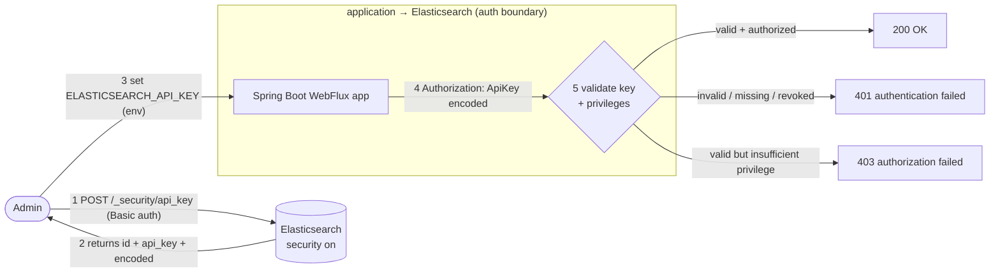

# 🔐 Chapter 02 — API Key Authentication

> บทนี้สาธิตการเชื่อมต่อ Spring Boot WebFlux กับ Elasticsearch ที่เปิดใช้งาน Security โดยใช้ **API Key Authentication**
> ผ่าน Elasticsearch Client สองรูปแบบ ได้แก่ **Spring Data Elasticsearch (Reactive)** และ **Elasticsearch Java API Client (Blocking)**
> พร้อมเรียนรู้การสร้าง API Key, การกำหนดสิทธิ์แบบ Least Privilege และการจัดการ Authentication และ Authorization Errors

## 📑 Table of Contents
- [Overview](#-overview)
- [Learning Objectives](#-learning-objectives)
- [Prerequisites](#-prerequisites)
- [Basic Auth vs API Key](#-basic-auth-vs-api-key)
- [How API Key Authentication Works](#-how-api-key-authentication-works)
- [Project Structure](#-project-structure)
- [Configuration](#-configuration)
- [Getting Started](#-getting-started)
- [Create and Configure API Key](#-create-and-configure-api-key)
- [API Examples](#-api-examples)
- [Authentication vs Authorization (401 / 403)](#-authentication-vs-authorization-401--403)
- [Testing](#-testing)
- [Troubleshooting & Security Considerations](#-troubleshooting--security-considerations)
- [Cleanup](#-cleanup)
- [Key Takeaways](#-key-takeaways)

## 🔐 Overview
ต่อยอดจาก Chapter 01 (เชื่อมต่อแบบไม่มี auth) มาเป็นการเชื่อมต่อ Elasticsearch ที่ **เปิด security** จริง
แอปเรียก **cluster health** และ **cluster info** ด้วยทั้งสอง client ที่ authenticate ด้วย **API key เดียวกัน**
ผ่าน property ของ Spring Boot โดยไม่ hardcode และไม่ log ค่า key

## 🎯 Learning Objectives
เมื่อจบบทนี้ คุณจะสามารถ:
- เปิด Elasticsearch security และเข้าใจความต่างระหว่าง **Basic Authentication** กับ **API Key Authentication**
- เข้าใจว่า Elasticsearch API Key ทำงานอย่างไร (สร้าง / ใช้ / invalidate / least-privilege)
- ตั้งค่า Spring Boot ให้ทั้งสอง client auth ด้วย API key ผ่าน property เดียว โดยไม่ hardcode / ไม่ log key
- จัดการและแยกแยะ **authentication failure (401)** ออกจาก **authorization failure (403)** พร้อม error ที่ไม่ leak ข้อมูล

## 📋 Prerequisites
- Java 21
- Maven
- Docker + Docker Compose
- `curl` และ `jq` (สำหรับตัวอย่างใน README)

## 🧠 Basic Auth vs API Key

| หัวข้อ | Basic Authentication | API Key Authentication |
|---|---|---|
| credential | `username:password` (เช่น `elastic`) | key เฉพาะกิจ (`id` + `api_key`) |
| ขอบเขตสิทธิ์ | ตามสิทธิ์ของ user (มักกว้าง) | จำกัดได้ด้วย `role_descriptors` (least-privilege) |
| เพิกถอน | ต้องเปลี่ยนรหัสผ่าน user | invalidate key ได้ทันที ไม่กระทบ user |
| หมดอายุ | ไม่มีในตัว | ตั้ง `expiration` ได้ |
| เหมาะกับ | งาน admin ชั่วคราว | service-to-service / ฝังในแอป |

สรุป: อย่าฝัง credential ของ superuser ไว้ในแอป — ใช้ **API key แบบจำกัดสิทธิ์** แทน

## 🔄 How API Key Authentication Works
1. ผู้ดูแล (principal ที่มีสิทธิ์ เช่น `elastic`) เรียก `POST /_security/api_key` พร้อม `role_descriptors` เพื่อจำกัดสิทธิ์
2. Elasticsearch คืน `id`, `api_key` และ `encoded` (ค่า `base64(id:api_key)`)
3. แอปรับค่า `encoded` ผ่าน **environment variable** (`ELASTICSEARCH_API_KEY`) — ไม่ hardcode
4. ทุก request จากแอปไปยัง ES แนบ header `Authorization: ApiKey <encoded>` (ทั้งสอง client)
5. Elasticsearch ตรวจ key + privileges
6. ถ้าผ่าน → 200; ถ้า key ไม่ถูกต้อง → **401**; ถ้าสิทธิ์ไม่พอ → **403**



> API consumer ทั่วไป **ไม่เคยเห็น** ค่า API key — key ถูกใช้เฉพาะช่วงที่แอปคุยกับ Elasticsearch เท่านั้น
> และ API key ใช้ได้ต่อเมื่อเปิด security (บทนี้ `xpack.security.enabled=true`)

## 📁 Project Structure
โครงสร้างแบบ layered เหมือน Chapter 01

```text
02-api-key-authentication/
├── .env.example
├── .gitignore
├── docker-compose.yml
├── pom.xml
├── README.md
├── VERIFICATION.md
└── src/
    ├── main/
    │   ├── java/com/example/learning/apikeyauth/
    │   │   ├── controller/
    │   │   │   ├── JavaClientConnectionController.java
    │   │   │   └── SpringDataConnectionController.java
    │   │   ├── dto/
    │   │   │   ├── ClusterHealthResponse.java
    │   │   │   └── ClusterInfoResponse.java
    │   │   ├── exception/
    │   │   │   └── GlobalExceptionHandler.java
    │   │   ├── service/
    │   │   │   ├── JavaClientConnectionService.java
    │   │   │   └── SpringDataConnectionService.java
    │   │   └── ApiKeyAuthenticationApplication.java
    │   └── resources/
    │       └── application.yml
    └── test/
        └── java/com/example/learning/apikeyauth/
            ├── controller/
            │   ├── JavaClientConnectionControllerTest.java
            │   └── SpringDataConnectionControllerTest.java
            ├── exception/
            │   ├── ErrorThrowingTestController.java
            │   └── GlobalExceptionHandlerTest.java
            ├── integration/
            │   └── ApiKeyAuthenticationIT.java
            └── service/
                ├── JavaClientConnectionServiceTest.java
                └── SpringDataConnectionServiceTest.java
```

**ความรับผิดชอบของแต่ละ package:**
- `controller/` — HTTP layer (thin) ของทั้งสอง client
- `service/` — เชื่อมต่อ Elasticsearch (reactive vs blocking) แยกชัดเจน
- `dto/` — response contract เป็น `record`
- `exception/` — `GlobalExceptionHandler` จำแนก error (รวม 401/403) โดยไม่ leak ข้อมูล
- application class อยู่ root package

## ⚙️ Configuration

| สิ่งที่ใช้ | เวอร์ชัน |
|---|---|
| Java | 21 |
| Spring Boot | 4.1.2 |
| Spring Data Elasticsearch | 6.1.2 |
| Elasticsearch Java API Client (`co.elastic.clients`) | 9.4.8 |
| Elasticsearch server (Docker image) | 9.4.8 |
| Testcontainers | 2.0.5 |

`application.yml` (ย่อ):
```yaml
spring:
  elasticsearch:
    uris: ${ELASTICSEARCH_URIS:http://localhost:9200}
    api-key: ${ELASTICSEARCH_API_KEY:}   # ตั้งค่า auth ให้ทั้งสอง client พร้อมกัน
server:
  port: ${SERVER_PORT:8081}
```

Environment variables:
- `ELASTIC_PASSWORD` — รหัสผ่าน `elastic` superuser (ใช้โดย docker-compose และตอนสร้าง API key)
- `ELASTICSEARCH_API_KEY` — ค่า `encoded` ของ API key ที่แอปใช้
- `ELASTICSEARCH_URIS` — ดีฟอลต์ `http://localhost:9200`
- `SERVER_PORT` — ดีฟอลต์ `8081`

## 🚀 Getting Started

**1) เข้าไปที่ไดเรกทอรีของบทนี้**
```bash
cd 02-api-key-authentication
```

**2) ตั้งรหัสผ่าน elastic (local เท่านั้น)**
```bash
export ELASTIC_PASSWORD='local-dev-password'
```

**3) สตาร์ท Elasticsearch (security เปิด)**
```bash
docker compose -p ch02 up -d
```

**4) ตรวจ readiness + ยืนยันว่า security เปิดจริง**
```bash
# ใส่ credential ถูก → 200
curl -s -o /dev/null -w "%{http_code}\n" -u "elastic:${ELASTIC_PASSWORD}" http://127.0.0.1:9200/_cluster/health
# ไม่ใส่ credential → 401 (พิสูจน์ว่า security ทำงาน)
curl -s -o /dev/null -w "%{http_code}\n" http://127.0.0.1:9200/_cluster/health
```

**5) สร้าง API key แบบ least-privilege** — ดูรายละเอียดใน [Create and Configure API Key](#-create-and-configure-api-key)

**6) ตั้งค่า environment variables ให้แอป**
```bash
export ELASTICSEARCH_API_KEY='<ค่า encoded จากขั้นตอนที่ 5>'
```
> ⚠️ การ `cp .env.example .env` **ไม่ได้** ทำให้ Spring Boot โหลดไฟล์ `.env` อัตโนมัติ (บทนี้ไม่ใช้ dotenv library)
> `.env.example` เป็นเพียงเอกสารอ้างอิงค่าที่ต้องใช้ ให้ `export` ตัวแปรเองใน shell หรือส่งตอนรัน process เช่น
> `ELASTICSEARCH_API_KEY=... java -jar target/api-key-authentication.jar`

**7) รันแอป**
```bash
mvn -DskipTests package
java -jar target/api-key-authentication.jar
# หรือ: ELASTICSEARCH_API_KEY=... mvn spring-boot:run
```

**8) เรียก API ตัวอย่าง** — ดู [API Examples](#-api-examples)

**9) หยุดและเก็บกวาด** — ดู [Cleanup](#-cleanup)

## 🔑 Create and Configure API Key
สร้าง key ด้วย `elastic` superuser พร้อมจำกัดสิทธิ์เท่าที่บทนี้ต้องใช้ (cluster health/info → `cluster:["monitor"]`):
```bash
export ELASTIC_PASSWORD='local-dev-password'
curl -s -u "elastic:${ELASTIC_PASSWORD}" -H 'Content-Type: application/json' \
  -XPOST http://127.0.0.1:9200/_security/api_key -d '{
    "name": "chapter02-app-key",
    "role_descriptors": { "ch02_reader": { "cluster": ["monitor"], "indices": [] } }
  }' | jq .
```
ตัวอย่างผลลัพธ์ (ค่าเหล่านี้เป็นตัวอย่างสมมติ):
```json
{
  "id": "VuaCfGcBCd...",
  "name": "chapter02-app-key",
  "api_key": "ui2lp2axТ...",
  "encoded": "VnVhQ2ZHY0JDZC4uLjp1aTJscDJheFQuLi4="
}
```

อธิบาย field สำคัญ:
- **`id`** — ตัวระบุของ key (ใช้ตอนเพิกถอน)
- **`api_key`** — secret ดิบ (ปกติไม่ได้ใช้ตรง ๆ ในแอปนี้)
- **`encoded`** — `base64(id:api_key)` → **ค่านี้คือสิ่งที่แอปใช้** (ตั้งใน `ELASTICSEARCH_API_KEY`)
- **`role_descriptors`** — นิยามสิทธิ์ของ key; **`cluster:["monitor"]`** = สิทธิ์ขั้นต่ำสำหรับ health/info ไม่ให้สิทธิ์ index/write
- header ที่ ES ต้องการคือ **`Authorization: ApiKey <encoded>`** (Spring Boot ใส่ให้อัตโนมัติจาก property `spring.elasticsearch.api-key`)

> ⚠️ แอปใช้ค่า **`encoded`** ไม่ใช่ `api_key` ดิบ — ใส่ผิดตัวจะได้ 401
> อย่า commit ค่า key จริง และอย่า log ค่า key / Authorization header

## 🌐 API Examples
ทุก endpoint เป็น `GET` และต้องมี API key ที่ถูกต้อง (มิฉะนั้นได้ 401/403) base URL: `http://127.0.0.1:8081`

### Spring Data Elasticsearch

**Cluster health** — `GET /api/spring-data/elasticsearch/health`
```bash
curl --fail-with-body -s http://127.0.0.1:8081/api/spring-data/elasticsearch/health | jq .
```
```json
{"client":"spring-data","clusterName":"docker-cluster","status":"green","numberOfNodes":1,"reachable":true}
```

**Cluster information** — `GET /api/spring-data/elasticsearch/cluster-info`
```bash
curl --fail-with-body -s http://127.0.0.1:8081/api/spring-data/elasticsearch/cluster-info | jq .
```
```json
{"client":"spring-data","clusterName":"docker-cluster","clusterUuid":"<uuid>","versionNumber":"9.4.8","tagline":"You Know, for Search"}
```

### Official Elasticsearch Java API Client

**Cluster health** — `GET /api/java-client/elasticsearch/health`
```bash
curl --fail-with-body -s http://127.0.0.1:8081/api/java-client/elasticsearch/health | jq .
```
```json
{"client":"java-client","clusterName":"docker-cluster","status":"green","numberOfNodes":1,"reachable":true}
```

**Cluster information** — `GET /api/java-client/elasticsearch/cluster-info`
```bash
curl --fail-with-body -s http://127.0.0.1:8081/api/java-client/elasticsearch/cluster-info | jq .
```
```json
{"client":"java-client","clusterName":"docker-cluster","clusterUuid":"<uuid>","versionNumber":"9.4.8","tagline":"You Know, for Search"}
```

> ทั้งสอง client ติดต่อ cluster เดียวกัน ค่าจึงตรงกัน ต่างแค่ field `client`
> ค่า **dynamic**: `clusterUuid` สุ่มใหม่ต่อ cluster, `clusterName` = `docker-cluster` (ดีฟอลต์ image), `status` ∈ `green`/`yellow`/`red`, `versionNumber` = `9.4.8` (pin image)

## 🛡️ Authentication vs Authorization (401 / 403)
`GlobalExceptionHandler` จำแนก error ตามสาเหตุจริง และ body เป็น generic `ProblemDetail` เสมอ (ไม่ leak key/host/uri/stack trace)

| กรณี | HTTP status | title |
|---|---|---|
| Valid API key + สิทธิ์พอ | 200 | — |
| key หาย / ผิด / หมดอายุ / ถูกเพิกถอน (ES ตอบ 401) | **401** | `Elasticsearch authentication failed` |
| key ถูกต้องแต่สิทธิ์ไม่พอ (ES ตอบ 403) | **403** | `Elasticsearch authorization failed` |
| ES ตอบ error response อื่น | **502** | `Elasticsearch returned an error` |
| ติดต่อ ES ไม่ได้ (unreachable / I/O) | **503** | `Elasticsearch unavailable` |
| request ไป ES timeout | **504** | `Elasticsearch timeout` |
| error อื่นที่ไม่คาดคิดในแอป | **500** | `Internal server error` |

- **401 (authentication)** = ยืนยัน "ตัวตน" ไม่ผ่าน — key หาย/ผิด/หมดอายุ/ถูกเพิกถอน
- **403 (authorization)** = ตัวตนถูกต้องแต่ "สิทธิ์" ไม่พอ (เช่น key ไม่มี `cluster:monitor`)

### ทดสอบ invalid API key (ได้ 401)
เพื่อไม่ให้สับสนกับแอปตัวเดิมที่รันอยู่บนพอร์ต 8081 ให้ทำแบบใดแบบหนึ่ง:

**วิธี A — หยุดแอปเดิมก่อน แล้วรันด้วย key ผิดบนพอร์ตเดิม**
```bash
# หยุดแอปเดิม (Ctrl+C ใน terminal ที่รันอยู่) จากนั้น:
ELASTICSEARCH_API_KEY='bm90LWEtcmVhbC1pZDpub3QtYS1yZWFsLXNlY3JldA==' \
  java -jar target/api-key-authentication.jar
# อีก terminal:
curl -s -w ' STATUS=%{http_code}\n' http://127.0.0.1:8081/api/java-client/elasticsearch/health
# คาดหวัง → {"title":"Elasticsearch authentication failed","status":401,...}  STATUS=401
```

**วิธี B — รัน instance แยกบนพอร์ตอื่น (เช่น 8091) โดยไม่ต้องหยุดตัวเดิม**
```bash
SERVER_PORT=8091 ELASTICSEARCH_API_KEY='bm90LWEtcmVhbC1pZDpub3QtYS1yZWFsLXNlY3JldA==' \
  java -jar target/api-key-authentication.jar
# รอให้ขึ้นว่า "Netty started on port 8091" ก่อน แล้วยิงไปที่ 8091 (อย่ายิง 8081):
curl -s -w ' STATUS=%{http_code}\n' http://127.0.0.1:8091/api/java-client/elasticsearch/health
# คาดหวัง → STATUS=401
# เสร็จแล้วหยุด instance นี้ด้วย Ctrl+C เพื่อไม่ให้ค้าง
```

> ค่า key ตัวอย่างข้างบนเป็น base64 ของสตริงสมมติที่ไม่ใช่ key จริง จึงได้ 401 เสมอ

## 🧪 Testing
```bash
mvn clean verify
```
- **Unit tests** (surefire): controller slice (`@WebFluxTest`, mock service), service (`StepVerifier` + mapping + blocking isolation + lazy), exception handler (401/403/502/503/504/500 + no-leak)
- **Integration tests** (failsafe, `ApiKeyAuthenticationIT`): สตาร์ต Elasticsearch 9.4.8 ที่ **เปิด security** จริงด้วย Testcontainers → สร้าง API key จริง → ยืนยันทั้งสอง client auth ผ่าน + เคส invalid key ได้ 401
- **ต้องเปิด Docker daemon** เพราะ integration test ใช้ Testcontainers — ถ้า Docker ไม่ทำงาน `mvn clean verify` จะไม่ผ่าน

## ⚠️ Troubleshooting & Security Considerations

### Troubleshooting
- **Elasticsearch ยังไม่พร้อม / สร้าง key ได้ 401**: security ใช้เวลา init — รอจน `-u elastic:... /_cluster/health` ตอบ 200 ก่อนค่อยสร้าง key
- **แอปได้ 401 ทั้งที่คิดว่า key ถูก**: ตรวจว่าใช้ค่า **`encoded`** (ไม่ใช่ `api_key` ดิบ) และ env ถูกส่งเข้า process จริง
- **แอปได้ 403**: key สิทธิ์ไม่พอ — เพิ่ม `cluster:["monitor"]` ใน `role_descriptors`
- **ไม่ได้ตั้ง environment variable**: `ELASTICSEARCH_API_KEY` ว่าง → ได้ 401; `ELASTIC_PASSWORD` ไม่ตั้ง → docker compose จะ fail พร้อมข้อความเตือน
- **พอร์ตชน** (`9200`/`8081`): แก้ `SERVER_PORT` หรือ mapping ใน `docker-compose.yml`
- **Docker ไม่พร้อม**: integration test และคำสั่ง cURL จะล้มเหลว — เปิด Docker daemon ก่อน

### Security Considerations
- บทนี้ปิด TLS บน HTTP layer (`xpack.security.http.ssl.enabled=false`) **เพื่อความง่ายใน local เท่านั้น** — production **ต้องเปิด HTTPS** เสมอ ไม่งั้น API key ถูกส่งแบบ clear text
- bind `127.0.0.1` เท่านั้น ห้าม expose node ออกนอกเครื่อง
- ใช้ **least-privilege** กับ API key เสมอ (บทนี้ให้แค่ `cluster:monitor`)
- ความลับมาจาก environment เท่านั้น, `.env` อยู่ใน `.gitignore`, ไม่ commit secret, ไม่ log key/Authorization header
- เพิกถอน key ที่ไม่ใช้/รั่วไหลทันที และพิจารณาตั้ง `expiration`:
  ```bash
  curl -s -u "elastic:${ELASTIC_PASSWORD}" -H 'Content-Type: application/json' \
    -XDELETE http://127.0.0.1:9200/_security/api_key -d '{"ids":["<KEY_ID>"]}' | jq .
  # → {"invalidated_api_keys":["<KEY_ID>"], ...}  หลังจากนี้ key เดิมจะได้ 401 ทันที
  ```

## 🧹 Cleanup
```bash
# หยุดแอปด้วย Ctrl+C (รวมถึง instance ทดสอบ invalid key ถ้ายังค้าง)
export ELASTIC_PASSWORD='local-dev-password'
docker compose -p ch02 down   # ลบ container + network (ไม่มี persistent volume)
```

## 📌 Key Takeaways
- API key เหมาะกับ service-to-service มากกว่าการฝัง credential ของ superuser; จำกัดสิทธิ์ด้วย `role_descriptors`
- Spring Boot ตั้ง auth ให้ทั้งสอง client ด้วย property เดียว (`spring.elasticsearch.api-key`) — ใช้ค่า `encoded`
- แยก **401 (authentication)** กับ **403 (authorization)** ให้ชัด และตอบ error แบบ generic ที่ไม่ leak ข้อมูล
- `.env.example` เป็นเอกสาร ไม่ได้ถูกโหลดอัตโนมัติ — ต้อง `export`/ส่ง env เอง
- ปิด TLS ได้เฉพาะ local; production ต้อง HTTPS เสมอ
