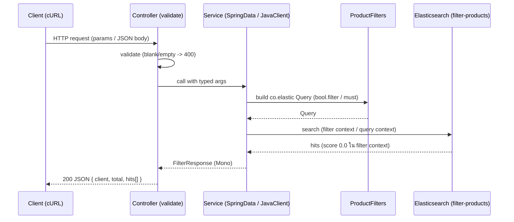

# Chapter 05 — Elasticsearch Filtering (term/terms, range, exists, filter context)

> โปรเจกต์ Spring Boot WebFlux อิสระ สาธิต **filtering** ของ Elasticsearch: `term`/`terms`, `range`
> (numeric + date), `exists` และการประกอบหลาย filter ด้วย `bool.filter` โดยเน้นแนวคิด
> **filter context vs query context** และผลต่อ `_score` บน product catalog เล็ก ๆ ด้วยสอง client
> (Spring Data reactive + official Java API Client) ที่รัน query เดียวกัน

หลังจบบทนี้คุณจะรันแอปที่กรองสินค้าด้วยเงื่อนไขหลายแบบได้จริง เห็นว่า filter ไม่คิด `_score`
(คืน `0.0`) ส่วน full-text query คิด `_score` และเข้าใจว่าเมื่อไหร่ควรใช้ filter แทน query

## สารบัญ
- [1. Learning Objectives](#1-learning-objectives)
- [2. Concepts: filter context vs query context](#2-concepts-filter-context-vs-query-context)
- [3. Filter types ในบทนี้](#3-filter-types-ในบทนี้)
- [4. Mappings และทำไมถึงสำคัญ](#4-mappings-และทำไมถึงสำคัญ)
- [5. ความต่างของสอง client](#5-ความต่างของสอง-client)
- [6. โครงสร้างโปรเจกต์](#6-โครงสร้างโปรเจกต์)
- [7. How It Works (request flow)](#7-how-it-works-request-flow)
- [8. Configuration](#8-configuration)
- [9. Getting Started](#9-getting-started)
- [10. API Examples และผลลัพธ์ที่คาดหวัง](#10-api-examples-และผลลัพธ์ที่คาดหวัง)
- [11. Testing](#11-testing)
- [12. Common mistakes](#12-common-mistakes)
- [13. Production considerations](#13-production-considerations)
- [เวอร์ชัน](#เวอร์ชัน)

---

## 1. Learning Objectives
เมื่อจบบทนี้คุณจะ:
- เข้าใจ **filter context vs query context** และผลต่อ `_score` (filter คืน `0.0` คงที่ ไม่คิด relevance)
- ใช้ `term` / `terms` filter บน `keyword` field (รวม boolean field เช่น `inStock`)
- ใช้ `range` filter กับ numeric และ date field พร้อมเข้าใจ inclusive (`gte`/`lte`) vs exclusive (`gt`/`lt`)
- ใช้ `exists` filter หา/ตัด document ที่มีหรือไม่มีค่าใน field
- ประกอบหลาย filter ด้วย `bool.filter` (AND) และตัดด้วย `must_not`
- ผสม full-text `match` (query context, scored) เข้ากับ filter (ไม่ scored) ในคำขอเดียว
- เข้าใจแนวคิด filter caching และเหตุผลที่ filter มักเร็วและ reuse ได้
- เปรียบเทียบ Spring Data Elasticsearch กับ official Java API Client บน filter เดียวกัน

## 2. Concepts: filter context vs query context
Elasticsearch ประเมิน query clause ใน 2 บริบท:

| | Query context | Filter context |
|---|---|---|
| คำถามที่ตอบ | "เอกสารนี้ **ตรงแค่ไหน**" | "เอกสารนี้ **ตรงหรือไม่** (yes/no)" |
| มีผลต่อ `_score` | ใช่ (ยิ่งตรงยิ่งสูง) | ไม่ (`_score` คงที่ = `0.0`) |
| ตัวอย่าง clause | `match`, `multi_match` | `term`, `terms`, `range`, `exists` ที่อยู่ใน `bool.filter` |
| cache ได้ | โดยทั่วไปไม่ | ได้ (node-level query cache) |
| ใช้เมื่อ | ต้องการ ranking | ต้องการคัดกรองล้วน ๆ |

> clause เดียวกัน (เช่น `term`) จะอยู่ context ไหนก็ได้ ขึ้นกับว่าวางไว้ที่ `must` (query) หรือ `filter`/`must_not` (filter)
> บทนี้วาง `term`/`terms`/`range`/`exists` ไว้ใน `bool.filter` เสมอ จึงเห็น `_score = 0.0` ชัดเจน

**ทำไมสำคัญ:** ถ้าไม่ต้องการ ranking ให้ใช้ filter — ได้ทั้งความเร็ว (cache) และความถูกต้องเชิงความหมาย (ไม่ให้ `_score` ที่ไม่มีความหมายมารบกวนการเรียงผล)

### Filter caching (แนวคิด)
Elasticsearch สามารถ cache ผลของ filter (bitset ว่า document ไหนผ่าน) ไว้ที่ระดับ node (query cache)
เพราะ filter ให้ผลแบบ yes/no ที่ re-use ได้ ต่างจาก query ที่คิดคะแนนตาม context การค้น
ในบทเรียนระดับนี้เราอธิบายแนวคิดไว้ ไม่ได้วัด cache hit แบบ deterministic (ไม่เหมาะกับขนาด dataset สาธิต)

## 3. Filter types ในบทนี้
| Filter | ใช้กับ field | ความหมาย | ตัวอย่าง |
|---|---|---|---|
| `term` | `keyword`, `boolean` | ค่า exact ตรงเป๊ะ | `category = laptop`, `inStock = true` |
| `terms` | `keyword` | ตรงกับค่าใดค่าหนึ่งในชุด (OR) | `brand ∈ {Apple, Dell}` |
| `range` (number) | numeric | ช่วงตัวเลข; `gte`/`lte` รวม, `gt`/`lt` ไม่รวม | `price >= 1000`, `4.0 < rating < 4.5` |
| `range` (date) | date | ช่วงวันที่ (`yyyy-MM-dd`) | `releaseDate 2024-01-01..2024-12-31` |
| `exists` | ทุกชนิด | มีค่าที่ field นั้น (ไม่ null/ไม่ absent) | `exists discountPercent` |
| `bool.must_not` | ประกอบ | ตัดเอกสารที่ match ออก | ไม่เอา `brand = Apple` |

## 4. Mappings และทำไมถึงสำคัญ
| Field | Type | ใช้สาธิต |
|---|---|---|
| id | `_id` | document id |
| name | `text` | full-text `match` (query context) |
| category | `keyword` | `term`/`terms` filter |
| brand | `keyword` | `terms` filter (multi-value OR) |
| price | `double` | numeric `range` (boundary inclusive/exclusive) |
| rating | `double` | numeric `range` (exclusive `gt`/`lt`) |
| releaseDate | `date` (`yyyy-MM-dd`) | date `range` |
| inStock | `boolean` | boolean `term` filter |
| discountPercent | `integer` (**nullable**) | `exists` filter |

- `keyword` ไม่ถูก analyze → เหมาะกับ `term`/`terms` (exact, case-sensitive)
- `date` ใช้ `format = yyyy-MM-dd` ชัดเจนเพื่อให้ date range query deterministic
- `discountPercent` จงใจเป็น `null` ในบาง document เพื่อให้ `exists` มีผลที่ตรวจสอบได้

## 5. ความต่างของสอง client
| | Spring Data (`ReactiveElasticsearchOperations`) | Java API Client (`ElasticsearchClient`) |
|---|---|---|
| โมเดล | reactive (non-blocking) | synchronous (blocking) |
| การ execute | `search(...)` คืน `Flux<SearchHit>` | `search(...)` คืน `SearchResponse` ต้อง offload |
| non-blocking | ใช่ โดยธรรมชาติ | ต้อง `Mono.fromCallable(...).subscribeOn(boundedElastic())` |
| query | `NativeQuery` ห่อ `co.elastic` Query | ใช้ `co.elastic` Query ตรง ๆ |

> ⚠️ การห่อ blocking call ไว้ใน `Mono` **ไม่ได้** ทำให้มันเป็น non-blocking — งานยัง blocking อยู่ เราแค่ย้ายไปรันบน worker thread (`boundedElastic`) เพื่อไม่ให้บล็อก event loop ของ reactor-netty
> ทั้งคู่ค้น index เดียวกัน (`filter-products`) ด้วย query ที่สร้างจาก `ProductFilters` ตัวเดียวกัน จึงให้ผล membership เดียวกัน

## 6. โครงสร้างโปรเจกต์
```text
05-elasticsearch-filtering/
├── src/
│   ├── main/
│   │   ├── java/
│   │   │   └── com/
│   │   │       └── example/
│   │   │           └── learning/
│   │   │               └── filtering/
│   │   │                   ├── config/
│   │   │                   │   └── DataInitializer.java
│   │   │                   ├── controller/
│   │   │                   │   ├── JavaClientFilterController.java
│   │   │                   │   └── SpringDataFilterController.java
│   │   │                   ├── data/
│   │   │                   │   └── SampleProducts.java
│   │   │                   ├── domain/
│   │   │                   │   └── Product.java
│   │   │                   ├── dto/
│   │   │                   │   ├── FilterResponse.java
│   │   │                   │   ├── FilterSearchRequest.java
│   │   │                   │   ├── ProductHit.java
│   │   │                   │   ├── RangeFilter.java
│   │   │                   │   └── TermsFilter.java
│   │   │                   ├── exception/
│   │   │                   │   ├── GlobalExceptionHandler.java
│   │   │                   │   └── InvalidFilterException.java
│   │   │                   ├── query/
│   │   │                   │   └── ProductFilters.java
│   │   │                   ├── service/
│   │   │                   │   ├── JavaClientFilterService.java
│   │   │                   │   └── SpringDataFilterService.java
│   │   │                   └── FilteringApplication.java
│   │   └── resources/
│   │       └── application.yml
│   └── test/
│       └── java/
│           └── com/
│               └── example/
│                   └── learning/
│                       └── filtering/
│                           ├── controller/
│                           │   ├── JavaClientFilterControllerTest.java
│                           │   └── SpringDataFilterControllerTest.java
│                           ├── integration/
│                           │   └── FilteringIT.java
│                           ├── query/
│                           │   └── ProductFiltersTest.java
│                           └── service/
│                               └── JavaClientFilterServiceTest.java
├── .env.example
├── .gitignore
├── docker-compose.yml
├── pom.xml
├── README.md
└── VERIFICATION.md
```

ความรับผิดชอบของแต่ละส่วน:
- `config/DataInitializer` — สร้าง index + mapping และ seed sample data ตอน startup แบบ non-destructive
- `controller/*` — รับ HTTP, validate parameter, เรียก service (thin)
- `data/SampleProducts` — catalog ตัวอย่าง deterministic 10 รายการ
- `domain/Product` — เอกสาร `filter-products` พร้อม field mapping
- `dto/*` — request/response records (`FilterSearchRequest`, `RangeFilter`, `TermsFilter`, `ProductHit`, `FilterResponse`)
- `exception/*` — `@RestControllerAdvice` + `InvalidFilterException` (semantic 400)
- `query/ProductFilters` — ตัวสร้าง `co.elastic.clients` Query ที่สอง client ใช้ร่วมกัน
- `service/*` — execute query ผ่าน Spring Data (reactive) และ Java API Client (blocking offloaded)

## 7. How It Works (request flow)


## 8. Configuration
| สิ่งที่ตั้งค่า | ค่า / env | หมายเหตุ |
|---|---|---|
| Elasticsearch URIs | `ELASTICSEARCH_URIS` (default `http://localhost:9200`) | HTTP (local, ไม่มี TLS) |
| API key (encoded) | `ELASTICSEARCH_API_KEY` | จาก create-API-key; ห้าม hardcode |
| App port | `SERVER_PORT` (default `8084`) | แยกจากบทอื่นเพื่อเลี่ยงชน |
| ES image | `elasticsearch:9.4.8` | security เปิด, TLS ปิด (local only) |
| Compose project | `ch05` | แยก namespace จากบทอื่น |

env vars ถูกอ่านผ่าน `application.yml`; คัดลอก `.env.example` เป็น `.env` (ซึ่ง gitignored) แล้วเติมค่า

## 9. Getting Started
### Prerequisites
- Java 21, Maven, Docker + Docker Compose

### ขั้นตอน
```bash
# 1) เข้าโฟลเดอร์บท
cd 05-elasticsearch-filtering

# 2) ตั้งรหัสผ่าน bootstrap แล้วสตาร์ท Elasticsearch (security เปิด)
export ELASTIC_PASSWORD='local-dev-password'
docker compose -p ch05 up -d

# 3) ตรวจ readiness (คาดหวัง 200)
curl -s -o /dev/null -w "%{http_code}\n" -u "elastic:${ELASTIC_PASSWORD}" \
  "http://127.0.0.1:9200/_cluster/health?wait_for_status=yellow&timeout=5s"
```

สร้าง API key แบบ least-privilege (มีสิทธิ์เฉพาะ index `filter-products`):
```bash
curl -s -u "elastic:${ELASTIC_PASSWORD}" -H 'Content-Type: application/json' \
  -XPOST http://127.0.0.1:9200/_security/api_key -d '{
    "name": "ch05-app",
    "role_descriptors": {
      "filter": {
        "cluster": ["monitor"],
        "indices": [
          { "names": ["filter-products"],
            "privileges": ["create_index","read","write","view_index_metadata"] }
        ]
      }
    }
  }' | jq -r .encoded
```

รันแอป (นำค่า `encoded` ไปใส่ env):
```bash
export ELASTICSEARCH_API_KEY='<encoded key>'
mvn -DskipTests package
java -jar target/elasticsearch-filtering.jar
```
แอปจะสร้าง index `filter-products` + mapping และ **seed ตัวอย่าง 10 รายการ** ตอน startup
**เฉพาะเมื่อ index ยังไม่มี** (non-destructive) ถ้ามีอยู่แล้วจะไม่ลบ/ไม่ seed ซ้ำ

reset dataset: ลบ index แล้ว restart แอป
```bash
curl -s -u "elastic:${ELASTIC_PASSWORD}" -XDELETE http://127.0.0.1:9200/filter-products
```

cleanup:
```bash
docker compose -p ch05 down
```
> `down` ลบ container + network แต่บทนี้ไม่ได้ประกาศ named volume จึงไม่มี persistent data ถูกลบ

## 10. API Examples และผลลัพธ์ที่คาดหวัง
มีสอง prefix คู่ขนาน: `/api/spring-data/products/filter/**` และ `/api/java-client/products/filter/**`
response: `{ "client": "...", "total": N, "hits": [ { id, name, category, brand, price, rating, releaseDate, inStock, discountPercent, score } ] }`

> ใน filter context ทุก hit จะมี `score = 0.0` (filter ไม่คิด relevance) ค่า `_id` และ field อื่น ๆ เป็น deterministic ตาม sample data

```bash
base=http://127.0.0.1:8084

# term (keyword exact) category=laptop -> p01,p02,p03,p04,p05
curl -s "$base/api/spring-data/products/filter/term?field=category&value=laptop" | jq '{total, ids:[.hits[].id]}'

# boolean term inStock=true -> p01,p02,p04,p06,p07,p08,p10
curl -s "$base/api/java-client/products/filter/term/boolean?field=inStock&value=true" | jq '{ids:[.hits[].id]}'

# terms (OR) brand in {Apple,Dell} -> p01,p02,p03,p06,p10
curl -s "$base/api/spring-data/products/filter/terms?field=brand&values=Apple,Dell" | jq '{ids:[.hits[].id]}'

# range price >= 1000 (inclusive, รวม p06 ที่ราคา 1000 พอดี) -> p01,p02,p03,p04,p05,p06
curl -s "$base/api/java-client/products/filter/range?field=price&type=number&gte=1000" | jq '{ids:[.hits[].id]}'

# range price > 1000 (exclusive, ตัด p06 ออก) -> p01,p02,p03,p04,p05
curl -s "$base/api/spring-data/products/filter/range?field=price&type=number&gt=1000" | jq '{ids:[.hits[].id]}'

# range 4.0 < rating < 4.5 (exclusive ทั้งสองด้าน) -> p04,p06,p08,p10
curl -s "$base/api/java-client/products/filter/range?field=rating&type=number&gt=4.0&lt=4.5" | jq '{ids:[.hits[].id]}'

# date range releaseDate ใน 2024 -> p01,p02,p06,p09
curl -s "$base/api/spring-data/products/filter/range?field=releaseDate&type=date&gte=2024-01-01&lte=2024-12-31" | jq '{ids:[.hits[].id]}'

# exists discountPercent (มีค่า) -> p01,p03,p05,p06,p08,p10
curl -s "$base/api/java-client/products/filter/exists?field=discountPercent" | jq '{ids:[.hits[].id]}'

# compose: หลาย filter AND (category=laptop AND price<=1500) -> p02,p03,p04
curl -s -XPOST "$base/api/spring-data/products/filter/compose" -H 'Content-Type: application/json' \
  -d '{"terms":[{"field":"category","values":["laptop"]}],"ranges":[{"field":"price","type":"number","lte":"1500"}]}' | jq '{ids:[.hits[].id]}'

# compose: must_not (laptop แต่ไม่เอา brand=Apple) -> p03,p04,p05
curl -s -XPOST "$base/api/java-client/products/filter/compose" -H 'Content-Type: application/json' \
  -d '{"terms":[{"field":"category","values":["laptop"]}],"mustNotTerms":[{"field":"brand","values":["Apple"]}]}' | jq '{ids:[.hits[].id]}'
```

### filter context vs query context (ดู `_score`)
```bash
# filter ล้วน -> ทุก hit score = 0.0
curl -s "$base/api/spring-data/products/filter/term?field=category&value=laptop" | jq '[.hits[].score] | unique'
# -> [0.0]

# full-text query 'gaming' (scored) + filter category=laptop (ไม่ scored) -> เหลือ p05, score > 0
curl -s -XPOST "$base/api/java-client/products/filter/compose" -H 'Content-Type: application/json' \
  -d '{"query":"gaming","terms":[{"field":"category","values":["laptop"]}]}' | jq '{id:.hits[0].id, score:.hits[0].score}'
# -> { "id": "p05", "score": 1.46... }  (ค่าคะแนนเป็น dynamic ตาม Lucene)
```
> `score` ใน query context เป็นค่า Lucene ที่เปลี่ยนได้ตาม scoring — ตรวจแค่ว่า `> 0` อย่า pin ค่า exact

### Input validation (ได้ HTTP 400)
ทุก invalid input จะได้ **HTTP 400** (sanitized `ProblemDetail`) **ก่อน** เรียก Elasticsearch — ไม่มี request ที่ไม่ถูกต้องหลุดไปถึง cluster

```bash
# field ว่าง -> 400
curl -s -w ' STATUS=%{http_code}\n' "$base/api/spring-data/products/filter/term?field=&value=laptop"
# range ไม่มี bound เลย -> 400 (Invalid filter)
curl -s -w ' STATUS=%{http_code}\n' "$base/api/spring-data/products/filter/range?field=price&type=number"
# range type ไม่รองรับ (ต้องเป็น number หรือ date เท่านั้น) -> 400
curl -s -w ' STATUS=%{http_code}\n' "$base/api/java-client/products/filter/range?field=price&type=invalid&gte=1"
# range bound ไม่ใช่ตัวเลข -> 400 (Invalid filter)
curl -s -w ' STATUS=%{http_code}\n' "$base/api/java-client/products/filter/range?field=price&type=number&gte=abc"
# range bound ไม่ finite (NaN / Infinity) -> 400
curl -s -w ' STATUS=%{http_code}\n' "$base/api/spring-data/products/filter/range?field=price&type=number&gte=NaN"
curl -s -w ' STATUS=%{http_code}\n' "$base/api/spring-data/products/filter/range?field=price&type=number&lte=Infinity"
# terms values ว่าง (compose) -> 400
curl -s -w ' STATUS=%{http_code}\n' -XPOST "$base/api/spring-data/products/filter/compose" \
  -H 'Content-Type: application/json' -d '{"terms":[{"field":"category","values":[]}]}'
# terms values มี element ว่าง/null (compose) -> 400 (ใช้ได้ทั้ง terms และ mustNotTerms)
curl -s -w ' STATUS=%{http_code}\n' -XPOST "$base/api/spring-data/products/filter/compose" \
  -H 'Content-Type: application/json' -d '{"terms":[{"field":"category","values":["   "]}]}'
# -> {"title":"Invalid request" หรือ "Invalid filter","status":400,...}
```
- parameter ที่จำเป็น (`field`, `value`, `type`, `values`) ต้องไม่ว่าง — ถ้าขาด/ว่าง จะได้ **400** ก่อนเรียก Elasticsearch
- **range `type` รองรับเฉพาะ `number` หรือ `date`** — ค่าชนิดอื่น (เช่น `invalid`) จะได้ **400** และ **ไม่** fall back เป็น numeric เงียบ ๆ (บังคับใช้ที่ `ProductFilters.range()` จึงปลอดภัยแม้เรียกตรง)
- `range` ต้องมีอย่างน้อยหนึ่ง bound และ numeric bound ต้องเป็น**ตัวเลขที่ finite** — `abc`, `NaN`, `Infinity`, `-Infinity` ทั้งหมดได้ **400**
- **terms `values` ต้องไม่ว่างและทุก element ต้องไม่เป็น `null`/blank** — บังคับใช้ทั้ง GET `/terms` (controller) และ POST `/compose` (bean validation `List<@NotBlank String>` ครอบคลุมทั้ง `terms` และ `mustNotTerms`)
- `empty result` (ไม่มี hit) = **200** + `hits` ว่าง ไม่ใช่ 404

## 11. Testing
```bash
mvn clean verify
```
- unit (surefire): controller slice ทั้งสอง client (term/terms/range/exists GET, compose POST, validation 400, empty 200), `ProductFilters` (สร้าง term/terms/range number+date/exists/compose + filter-context โครงสร้าง), Java client service (mapping, score normalization, empty, blocking isolation)
- integration (failsafe, Testcontainers, security เปิดจริง, API key, seed จริง): term/boolean term, terms OR, range inclusive/exclusive/date, exists + complement, compose AND/must_not, filter-context score = 0.0, query-context score > 0, empty, cross-client consistency
  - ต้องมี Docker daemon ทำงานอยู่ (Testcontainers จะสตาร์ท ES 9.4.8 เอง)

> ไม่ assert ค่า `_score` แบบ exact (ขึ้นกับ Lucene) — filter context assert เป็น `0.0`, query context assert `> 0` + membership

## 12. Common mistakes
- ใช้ `term` บน field `text` แล้วไม่เจอ → ใช้ `keyword` สำหรับ exact (เช่น `category`, `brand`)
- สับสน inclusive/exclusive → `gte`/`lte` รวม boundary, `gt`/`lt` ไม่รวม (ดู p06 ที่ราคา 1000 พอดี)
- คาดว่า filter จะมี `_score` → filter คืน `0.0` เสมอ ถ้าต้องการ ranking ให้ใช้ query (`match`)
- ใช้ `exists` แล้วงงว่าทำไมบาง document หาย → `null`/absent value ไม่ถือว่า exists (เช่น `discountPercent` ของ p02,p04,p07,p09)
- ลืมใส่ `type` ให้ range หรือใส่ค่าที่ไม่รองรับ → ต้องเป็น `number` หรือ `date` เท่านั้น ค่าอื่นได้ 400 (ไม่ fall back เป็น numeric)
- ส่ง `NaN`/`Infinity` เป็น numeric bound → ไม่ใช่ค่า finite จึงได้ 400 (ไม่ใช่ bound ที่ถูกต้อง)
- ส่ง terms `values` ที่มี element ว่าง/null → ได้ 400 (ต้อง non-blank ทุกตัว)
- assert ค่า `_score` แบบ exact ใน query context → เปราะ ควรตรวจ `> 0` + membership

## 13. Production considerations
- เปิด HTTPS บน HTTP layer เสมอใน production (บทนี้ปิด TLS เฉพาะ local)
- ใช้ filter เมื่อไม่ต้องการ ranking เพื่อประโยชน์จาก query cache และลดภาระ scoring
- ระวัง high-cardinality `terms` (รายการค่ายาวมาก) และ unbounded range ที่คืนผลจำนวนมาก (pagination อยู่ Chapter 07)
- date range ควรกำหนด `format`/time zone ให้ชัดเพื่อผลที่คาดเดาได้
- ใช้ least-privilege API key, ความลับผ่าน env, ไม่ commit secret, ไม่ log key/Authorization header
- อย่าใช้ immediate refresh ทุก write ใน production (บทนี้ใช้เพื่อ demo/seed)

---

## เวอร์ชัน
Java 21 · Spring Boot 4.1.2 · Spring Data Elasticsearch 6.1.2 · Elasticsearch Java client 9.4.8 · Elasticsearch server 9.4.8 · Testcontainers 2.0.5
